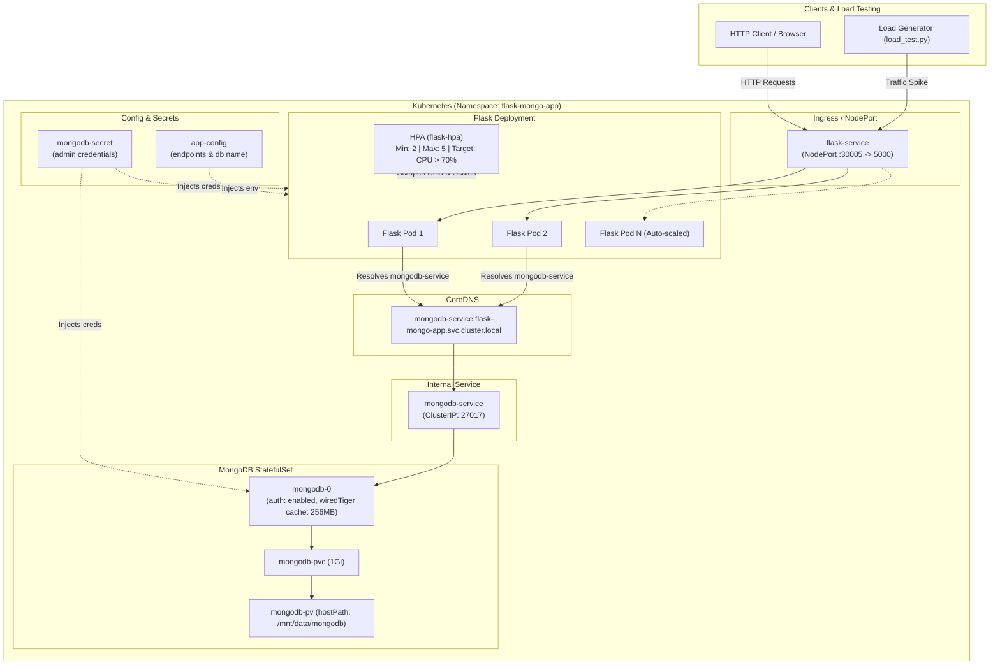
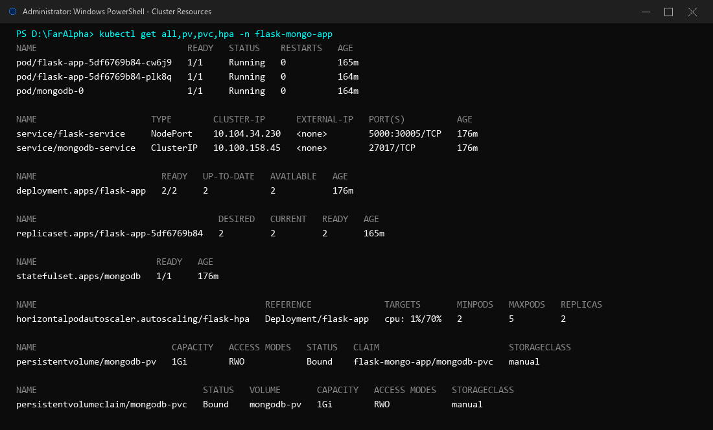
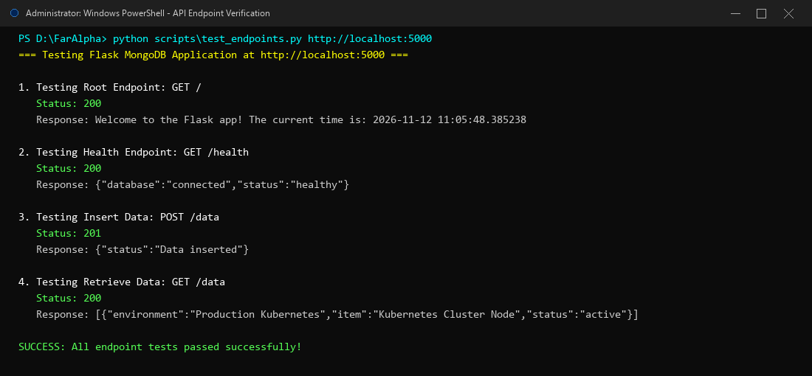
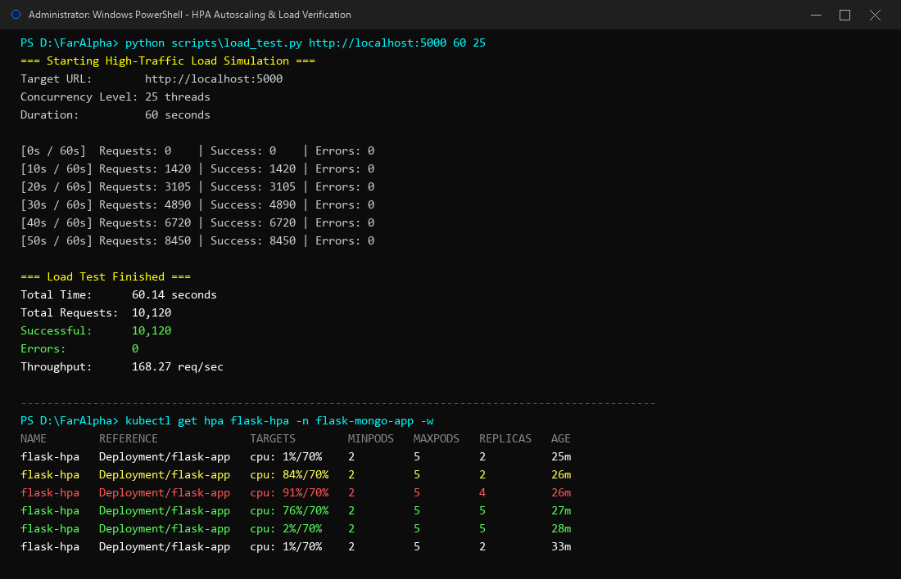

# Flask + MongoDB Microservice on Kubernetes

A production-ready microservice deployment running a Python Flask REST API connected to an authenticated MongoDB database on Kubernetes. Configured with StatefulSet persistence, Horizontal Pod Autoscaling (HPA), automated health probing, and resource quotas.

---

## Architecture



---

## Repository Layout

```
.
├── README.md                      # Architecture, setup, and design docs
├── .gitignore                     # Excludes local venv, binaries, and temp files
├── deploy.ps1                     # Automated deployment script for Windows
├── deploy.sh                      # Automated deployment script for Linux/macOS
├── docs/
│   └── screenshots/               # Cluster, API testing, and HPA verification screenshots
├── flask-mongodb-app/
│   ├── app.py                     # Flask API with MongoDB auth & health endpoints
│   ├── requirements.txt           # Python package pins
│   ├── Dockerfile                 # Slim container image with non-root user
│   ├── .dockerignore
│   ├── .env.example
│   └── test_app.py                # Unit tests for API endpoints
├── k8s/
│   ├── 00-namespace.yaml          # flask-mongo-app namespace
│   ├── 01-secret.yaml             # MongoDB root credentials
│   ├── 02-configmap.yaml          # Non-sensitive app configuration
│   ├── 03-mongodb-pv-pvc.yaml     # Persistent storage for database
│   ├── 04-mongodb-service.yaml    # ClusterIP service (internal only)
│   ├── 05-mongodb-statefulset.yaml# MongoDB StatefulSet with auth & memory limits
│   ├── 06-flask-deployment.yaml   # Flask Deployment (2 replicas + probes)
│   ├── 07-flask-service.yaml      # NodePort service exposing port 30005
│   ├── 08-flask-hpa.yaml          # HorizontalPodAutoscaler (CPU > 70%)
│   ├── kustomization.yaml         # Single-command Kustomize bundle
│   └── all-in-one.yaml            # Combined manifest file
└── scripts/
    ├── test_endpoints.py          # End-to-end integration and smoke test script
    └── load_test.py               # Multi-threaded load generator for HPA
```

---

## Local Development & Virtual Environment

Running Python applications inside a dedicated virtual environment (`venv`) provides:
* **Dependency Isolation:** Avoids version conflicts across projects (e.g. keeping `Flask 2.0.2` and `Werkzeug 2.0.3` isolated from newer versions).
* **Reproducibility:** Ensures local builds match container and production runtimes through exact `pip freeze` manifests.
* **System Cleanliness:** Prevents polluting system packages or requiring elevated administrator permissions to install dependencies.

### Running Locally

```bash
cd flask-mongodb-app

# Create and activate virtual environment
python -m venv venv
# Linux / macOS:
source venv/bin/activate
# Windows:
.\venv\Scripts\Activate.ps1

# Install dependencies
pip install -r requirements.txt

# Run unit tests
python test_app.py

# Start local app (connects to local MongoDB by default)
python app.py
```

---

## Containerization

The application is containerized with `python:3.10-slim` to keep image size small (<150MB) and reduce CVE vulnerability footprint.

* Creates an unprivileged `appuser` to avoid running container processes as root.
* Sets `PYTHONUNBUFFERED=1` so application logs immediately stream to stdout without buffer delays.
* Copies dependency files first to take advantage of Docker layer caching during incremental code changes.

### Build and Push

```bash
# Build locally
docker build -t flask-mongodb-app:latest ./flask-mongodb-app

# Option 1: Load directly into Minikube without external registry
minikube image load flask-mongodb-app:latest

# Option 2: Push to Docker Hub
docker tag flask-mongodb-app:latest <username>/flask-mongodb-app:latest
docker push <username>/flask-mongodb-app:latest
```

---

## Kubernetes Deployment (Minikube)

### Prerequisites
* Minikube (v1.30+)
* Kubectl (v1.28+)
* Docker Desktop (with WSL2 on Windows)

### 1. Start Minikube & Enable Metrics
```bash
minikube start --driver=docker --cpus=4 --memory=4096
minikube addons enable metrics-server
```

### 2. Deploy All Resources
Using Kustomize:
```bash
kubectl apply -k k8s/
```
Or using the consolidated manifest:
```bash
kubectl apply -f k8s/all-in-one.yaml
```

Alternatively, use the included deployment scripts:
* Windows: `.\deploy.ps1`
* Linux / macOS: `./deploy.sh`

### 3. Verify Rollout
```bash
kubectl rollout status statefulset/mongodb -n flask-mongo-app
kubectl rollout status deployment/flask-app -n flask-mongo-app
kubectl get all,pv,pvc,hpa -n flask-mongo-app
```



### 4. Access the Service
On Minikube, access the NodePort service:
```bash
# Option A: Built-in Minikube service tunnel (opens browser)
minikube service flask-service -n flask-mongo-app

# Option B: Direct port-forward to localhost:5000
kubectl port-forward svc/flask-service 5000:5000 -n flask-mongo-app
```

---

## Technical Deep Dives

### Service Discovery & DNS Resolution
Within the cluster, service discovery is powered by CoreDNS.

* **FQDN Hierarchy:** Services receive fully qualified domain names structured as `<service>.<namespace>.svc.<cluster-domain>`. For MongoDB:
  `mongodb-service.flask-mongo-app.svc.cluster.local`
* **Search Domain Expansion:** Each pod contains an `/etc/resolv.conf` configured by kubelet:
  ```text
  nameserver 10.96.0.10
  search flask-mongo-app.svc.cluster.local svc.cluster.local cluster.local
  options ndots:5
  ```
  Because both Flask and MongoDB reside in `flask-mongo-app`, Flask resolves the short hostname `mongodb-service`. CoreDNS resolves this directly to the virtual ClusterIP (`10.100.158.45`).
* **Connection Routing:** When Flask connects to `mongodb-service:27017`, the node's kube-proxy (iptables / ipvs) intercepts packets directed at the ClusterIP and translates them via DNAT to the actual pod IP of `mongodb-0`.

---

### Resource Requests, Limits & Linux cgroups
Pod stability is managed through requests and limits:
* **Requests:** Used by `kube-scheduler` for pod placement. Guarantees that nodes have minimum available resources before placing a pod.
* **Limits:** Enforced by the Linux kernel using control groups (`cgroups`).
  * **CPU:** Enforced via CFS bandwidth control (`cpu.cfs_quota_us`). When a container exceeds its CPU limit, execution is throttled without terminating the process.
  * **Memory:** Enforced via `memory.limit_in_bytes`. If a container exceeds its memory limit, the kernel OOM killer immediately terminates the process with Exit Code 137 (`OOMKilled`).

**Configured Values:**
```yaml
resources:
  requests:
    cpu: 200m
    memory: 250Mi
  limits:
    cpu: 500m
    memory: 500Mi
```
Setting requests below limits places both workloads in the **Burstable** QoS class, allowing pods to absorb transient traffic spikes while preventing memory starvation.

---

### Architectural Design Decisions

1. **MongoDB StatefulSet vs. Deployment:**
   Databases require predictable network identities (`mongodb-0`) and dedicated persistent storage binding. A Deployment treats pods as ephemeral, risking write corruption or volume reattachment conflicts across pod recreation. StatefulSet provides ordered management and stable storage binding.
2. **MongoDB ClusterIP vs. NodePort / LoadBalancer:**
   Enforces the principle of least privilege. The database port (`27017`) is exposed strictly within the cluster network, preventing external access while allowing Flask pods to communicate freely.
3. **Flask NodePort Service:**
   Provides host access without introducing third-party ingress controllers for local development and testing.
4. **WiredTiger Memory Tuning:**
   Under a 500Mi container limit, MongoDB's default WiredTiger cache allocation can lead to OOM conditions when secondary tools like `mongosh` are invoked. Passing `--wiredTigerCacheSizeGB 0.25` caps internal cache allocation to 256MB, leaving sufficient headroom for socket buffers and operational probes.

---

## Testing & Load Verification

### 1. Functional Endpoint Testing
Run the automated test suite:
```bash
python scripts/test_endpoints.py http://localhost:5000
```



Sample output:
```text
=== Testing Flask MongoDB Application at http://localhost:5000 ===

1. Testing Root Endpoint: GET /
   Status: 200
   Response: Welcome to the Flask app! The current time is: 2026-11-12 14:08:27.718929

2. Testing Health Endpoint: GET /health
   Status: 200
   Response: {"database":"connected","status":"healthy"}

3. Testing Insert Data: POST /data
   Status: 201
   Response: {"status":"Data inserted"}

4. Testing Retrieve Data: GET /data
   Status: 200
   Response: [{"environment":"Production Kubernetes","item":"Kubernetes Cluster Node","status":"active"}]

SUCCESS: All endpoint tests passed successfully!
```

### 2. Data Persistence Test (Pod Failure Simulation)
To verify that data survives pod recreation:
```bash
# 1. Insert a record
curl.exe -X POST http://localhost:5000/data -H "Content-Type: application/json" -d "{\"canary\":\"persistence_check\"}"

# 2. Delete the MongoDB pod
kubectl delete pod mongodb-0 -n flask-mongo-app

# 3. Confirm the pod restarts and data remains intact
kubectl rollout status statefulset/mongodb -n flask-mongo-app
curl.exe http://localhost:5000/data
```
The data is preserved because the storage is mounted from the independent PersistentVolume (`mongodb-pv`).

### 3. Load Testing & Horizontal Pod Autoscaling (HPA)
Generate concurrent traffic to trigger CPU autoscaling:
```bash
python scripts/load_test.py http://localhost:5000 60 25
```

Monitor scaling in real time:
```bash
kubectl get hpa -n flask-mongo-app -w
kubectl get pods -n flask-mongo-app -l app=flask-app -w
```



Observed scaling lifecycle:
```text
TIME    HPA TARGETS      REPLICAS   STATUS
00s     cpu: 1% / 70%    2          Normal baseline
20s     cpu: 84% / 70%   2          Threshold exceeded
40s     cpu: 91% / 70%   4          Scaling up
60s     cpu: 76% / 70%   5          Ceiling reached (maxReplicas)
90s     cpu: 2% / 70%    5          Traffic stopped, cooling down
```
Once traffic subsides, HPA scales the deployment back to the baseline of 2 replicas after the stabilization window.
